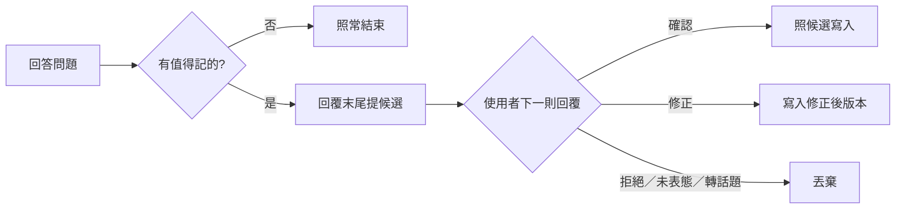

# 記憶收錄流程規範（完整版）

> 主準則 §11.4 只保留流程骨架，本檔補齊分類、候選驗證流程、寫入格式與通則升格。
> 適用 Antigravity 的 KI 與 Claude Code 的 auto memory（`~/.claude/projects/<專案>/memory/`）。「收什麼、不收什麼」照 §11.3 與 `knowledge-item-rules.md` 判斷，本檔管的是**分到哪一類**與**誰說了算**。

## 分類

| 類別 | 前綴 | 判準 | 必標項目 |
|------|------|------|---------|
| 專案 | `proj-` | 只在特定專案成立：拿掉專案名稱後陳述就不對 | 專案名稱、專案類型 |
| 環境 | `env-` | 不分專案，但綁特定機器、OS 或工具版本 | 機器或工具名稱 |
| 通則 | `gen-` | 換任何專案、任何機器都成立 | — |

**判斷順序**：先問「換專案還成立嗎」，不成立 → 專案；成立再問「換機器還成立嗎」，不成立 → 環境；都成立 → 通則。同時綁專案與環境時歸**專案**，並在內文註明環境條件。

### 專案類必標專案名稱與類型

- **專案名稱**：repo 根目錄名稱，例：`MKBackground`
- **專案類型**：該專案在整體系統中的角色與技術棧，例：`後台整併基底／Laravel`、`前台／React`、`收銀機前台／React＋WebView2`。依專案規則檔或 repo 實際內容填寫，查不到時標 `⚠️ 類型未知`，不自行推測

理由：專案記憶一旦被搬移、升格或被其他代理讀到，沒標專案就會被當成通則套用，正好是 §1.2「把專案事實與通則混為一談」的失真。

### 標示位置

| 平台 | 專案名稱與類型標在哪 |
|------|-------------------|
| Claude Code memory | 檔名與 `name`：`proj-<專案名稱小寫>-<主題>`；`description` 開頭：`[MKBackground｜後台整併基底／Laravel]`；內文第一行：`專案：MKBackground（後台整併基底／Laravel）` |
| Antigravity KI | `metadata.json` 的 `tags` 加 `project:<專案名稱>`、`project-type:<專案類型>`；`title` 前綴同 Claude Code |

`MEMORY.md` 索引依「專案／環境／通則」分組，專案組內再依專案名稱分小組。

## 候選 → 驗證 → 收錄

記憶的收錄權在使用者手上。代理只負責提候選，使用者確認後才寫入。



### 1. 什麼時候提候選

依優先序：

1. **使用者糾正了代理的回答**：糾正後的正確版本就是候選，優先度最高
2. 查證後得出、repo 與 git log 看不出來的專案事實（例：某站的特殊業務規則、某張表的實際用途）
3. 踩到環境坑，且已確認原因
4. 使用者表達了可重複套用的偏好

repo 查得到的、只在本次對話有意義的、一次性修復，照 §11.3 不提。

### 2. 候選格式

放在回覆最末尾，每則回覆最多 2 條：

```
【候選記憶】專案｜MKBackground（後台整併基底／Laravel）
內容：一句話陳述事實或規則
理由：為什麼值得記（具體事故或依據）
```

通則與環境類省略括號內的專案資訊，環境類改標機器或工具。

### 3. 驗證判定

以使用者的**下一則回覆**判定：

| 使用者回覆 | 處理 |
|-----------|------|
| 明確同意（「收」「OK」「記起來」） | 照候選內容寫入 |
| 修正候選內容或分類 | 寫入修正後的版本 |
| 拒絕、沒提到候選、話題已轉移 | 丟棄，不寫入，也不再追問 |

沒有明確同意就不寫入：未驗證的內容進了記憶，下個 session 會被當成事實引用。

**例外**：使用者主動說「記起來」並指明內容，本身就是驗證，直接寫入，不必再提候選。

### 4. 寫入

- 寫入前先找有沒有同主題的既有條目，有就更新那份，不另開新檔
- 寫入後在回覆中回報：檔名、類別、一句內容

## 平台註記

- **Claude Code 桌面版**：候選以回合結尾的下一步框按鈕詢問（「收錄」「不收」），候選內容仍要寫在回覆正文中
- **其他平台**：在回覆末尾以文字詢問

## 通則升格

記憶目錄依專案分開，記在某專案的通則只在該專案生效。符合以下任一條件時，提議升格寫進 `global-rules`：

- 同一條通則在 2 個以上專案被使用者確認過
- 使用者要求跨專案套用

升格經使用者核准後：改本倉庫的 `SKILL.md` 或 `resources/`，跑 `tools/sync-skills.ps1` 同步，再刪除各專案記憶中的原條目，避免常駐規則與記憶成為兩份真實來源（§11.1）。

---
**最後更新**: 2026-11-05
**維護者**: 開發團隊
**文件版本**: v1.0
**變更記錄**（里程碑，最多 5 條）:
- v1.0 (2026-11-05): 首版，定義專案／環境／通則分類、專案類必標專案名稱與類型、候選驗證收錄流程與通則升格條件
